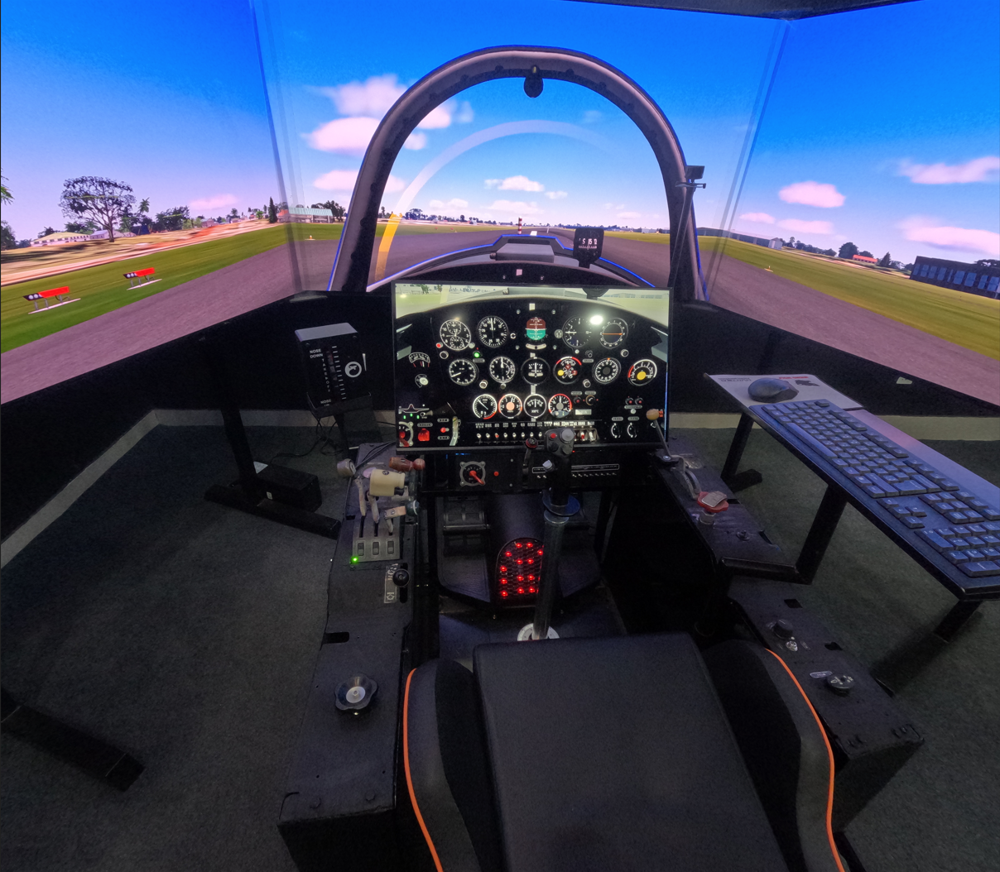
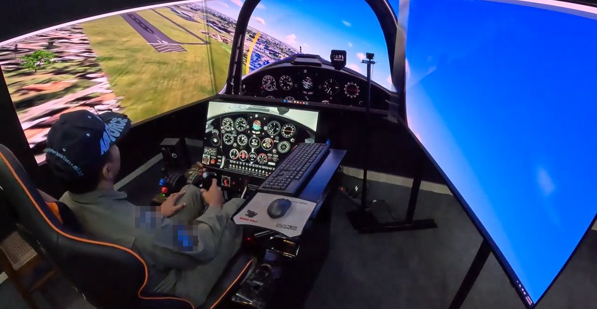
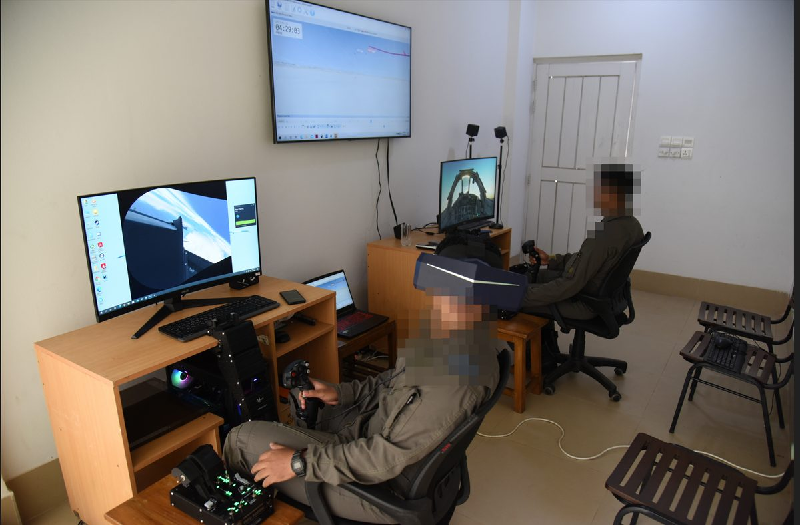
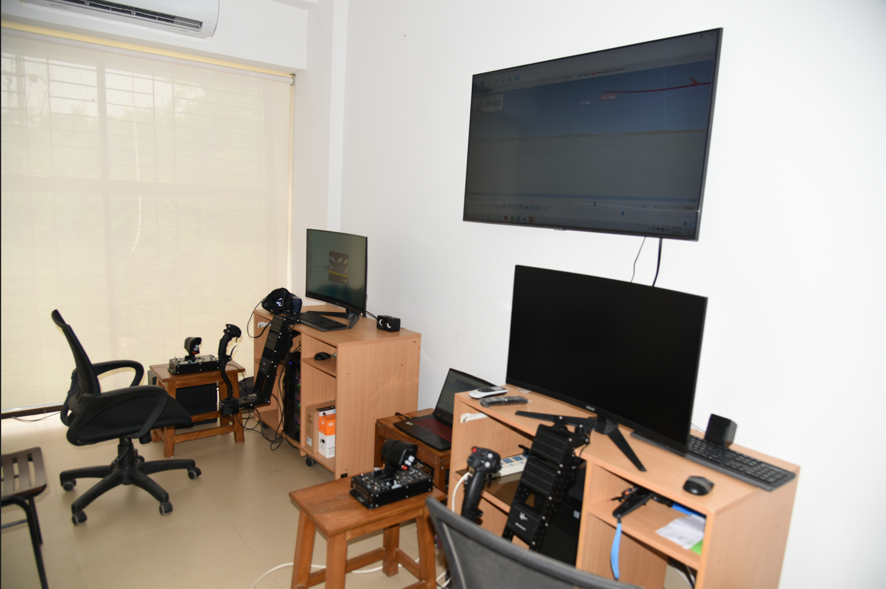
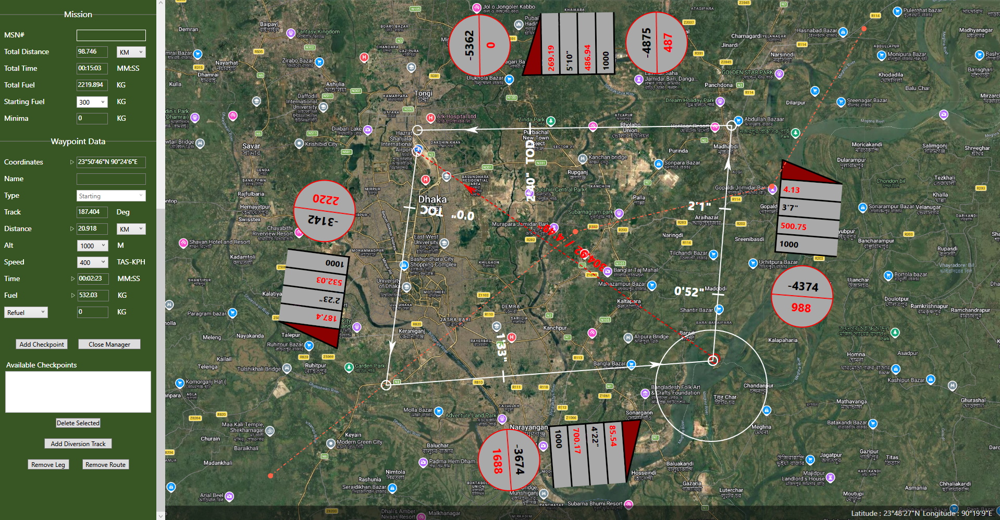
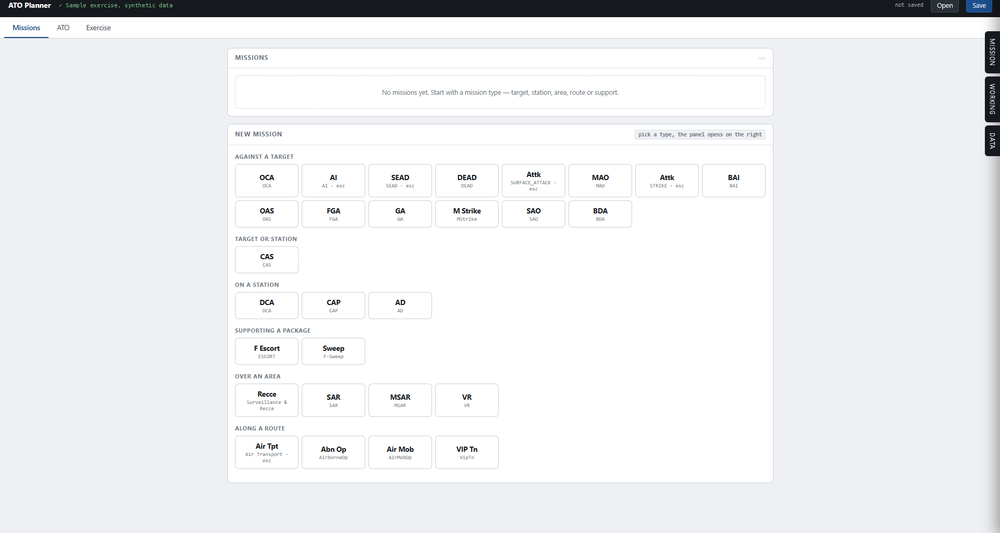
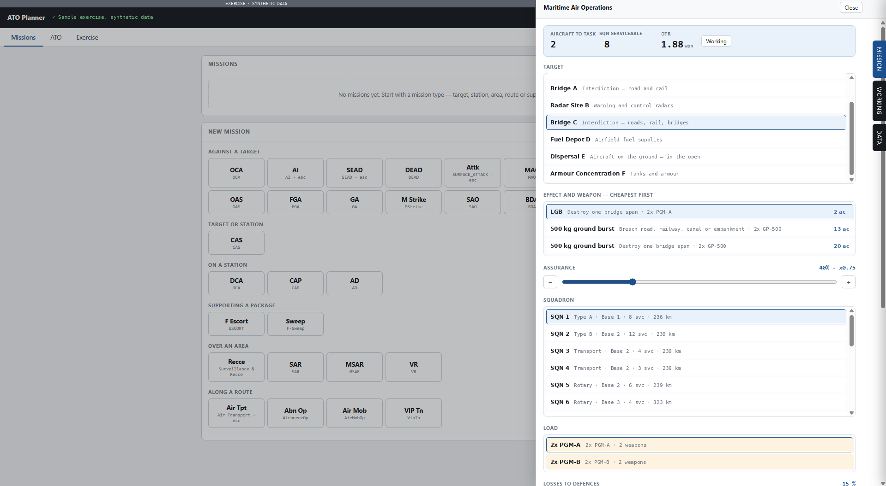

# Abu Jehad Arafat

Dhaka, Bangladesh · [aaaraafaat@outlook.com](mailto:aaaraafaat@outlook.com) · [LinkedIn](https://linkedin.com/in/aaaraafaat) · [CV (PDF)](cv/Arafat_CV_Academic_2026.pdf)

MSc in Data Science and Machine Learning. Flying instructor and former fighter pilot.
Applying for a PhD (Fall 2027) in robust machine perception and safe autonomy.

---

## MSc thesis

### Perception-Difficulty Estimation in Degraded Visual Environments
**Dark-Channel Fog Severity as a Safety Signal: Failure Modes and Limits on Real Fog**
*MSc · State University of Bangladesh · Degree awarded September 2026 · Paper under review at IEEE Transactions on Intelligent Vehicles.*

Can a free, training-free physics score tell a camera-based vehicle when fog is degrading its object detector, with no labels, no training, and no enhancement step? I audit the dark-channel fog-severity score as a per-image predictor of detection difficulty, and map exactly where and why it fails on real fog.

- **Method:** dark-channel severity (ω = 0.95, 15×15 window), calibrated on 2,000 synthetic-fog images and tested on real fog. Training-free, no dehazing
- **Data:** RTTS (RESIDE), 4,322 → 4,245 images after cleaning; per-image recall from three clear-trained detectors (YOLO-nano, YOLOv8-S, RT-DETR-L) as the difficulty signal
- **Headline result:** where the score reports "near-clear," **39.9%** of images are still detection failures; the best of 11 appearance descriptors separates them from genuinely clear scenes at only **AUC 0.686**. This is a false-reassurance failure mode
- **Cues studied, and where they fail:** dark channel, saturation, contrast, entropy, upper-region contrast, and a second free estimator (colour attenuation prior). All share the same blind spot on ordinary grey-daylight fog

**Takeaway:** trust a high score, never a low one.

Python · PyTorch · Ultralytics (YOLO, RT-DETR) · OpenCV · pandas · scikit-learn · SciPy

[Code and figures](https://github.com/aaaraafaat/perception-difficulty-dve)

---

## Projects

Training and simulation systems built for the Air Force.

### PC-based aviation training device

<table>
  <tr>
    <td width="30%" align="center"></td>
    <td width="50%" align="center"></td>
  </tr>
</table>

2024–2025. COTS hardware with Prepar3D and MSFS and a custom fixed-wing model, for ab-initio and part-task training. Project lead.

### VR combat simulator

<table>
  <tr>
    <td width="50%" align="center"></td>
    <td width="50%" align="center"></td>
  </tr>
</table>

2018. Delivered the concept for a VR part-task trainer, and later consulted on the build of a VR-based PCATD for combat training.

### Flying operations scheduling and progress monitoring (Rule based Auto Rostering and Execution Flow)

<table>
  <tr>
    <td width="33%" align="center"></td>
    <td width="33%" align="center"></td>
    <td width="33%" align="center"></td>
  </tr>
</table>

2025–2026. Web app that builds daily flying schedules against aircraft, instructor and trainee constraints, and tracks trainees through the syllabus.

### Flight planning tool (Navigation)

<table>
  <tr>
    <td width="50%" align="center"></td>
    <td width="50%"></td>
  </tr>
</table>

2019. Google Maps API with layered custom charts, for preparing mission route and navigation charts. I was project manager & UI designer.

### Wargame planning platform for Assets and Threats

<table>
  <tr>
    <td width="50%" align="center"></td>
    <td width="50%" align="center"></td>
  </tr>
</table>

2026. Web application for planning air missions in an exercise setting. Targets and mission types are selected from a data set, weapon and effect options are ranked by the number of aircraft each would cost, and aircraft to task is computed against squadron serviceability, assurance level and expected losses to defences. Made with Claude.

## Tools

`Python` · `PyTorch` · `OpenCV` · `pandas` · `scikit-learn` · `Ultralytics / YOLO` · `Git` · `LaTeX` · `Prepar3D / MSFS`

  

All images and screenshots on this page are of my own work and use synthetic or illustrative data. Nothing here represents the position of any other organisation.
